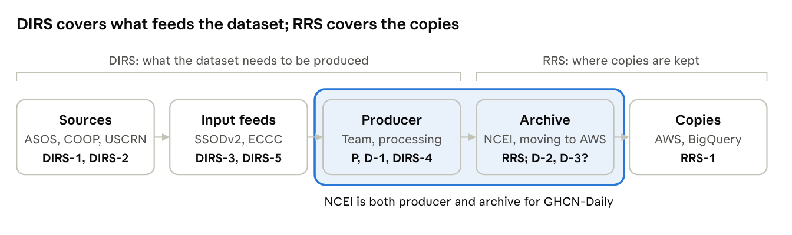

# Why R* categories are hard to apply

As of 2026-11-23. Copy of the Claude Doc [Why R* categories are hard to apply](https://claude.ai/artifact/Q5rmmJHnFzAtNLHsubpZKW);
edits made online after this date are not in this file.

## Purpose

The R* subcategories are easy to read but hard to apply: the same fact often fits two or three subcategories, and one
organization can be producer, steward and repository at once. This note lists where sorting web research into the 19
subcategories needed a judgment call, with examples from GHCN-Daily (three categorization passes, 210 evidence items),
and suggests changes that could make the rules clearer.

The four groups, as worded now:

- **People risk (P-1 to P-4):** the people who keep the dataset going — succession, retirement, undocumented knowledge,
  single points of failure.
- **Data risk (D-1 to D-5):** threats to the dataset as a product — defunding, storage, access, formats, politics.
- **Dependent infrastructure resilience (DIRS-1 to DIRS-5):** what the dataset needs in order to be produced —
  instruments and networks, their calibration, input feeds, processing, backups.
- **Repository resilience (RRS-1 to RRS-5):** how well the places that hold copies keep them — redundancy, checksums,
  disaster recovery, funding, track record.

R* = 0.40 D + 0.30 P + 0.20 (100 − RRS) + 0.10 DIRS. Each subcategory scores 0 or its points, and 0 when the evidence
is missing.

## Dataset, producer, repository: one organization can be all three

The hardest sorting problem is deciding which role a fact is about. For GHCN-Daily, NOAA NCEI produces the dataset,
stewards it and holds the archive copy, so almost every NCEI fact (budget, staff losses, the move to AWS, Hurricane
Helene) could be read as P, D, DIRS or RRS evidence.

| Role | GHCN-Daily | IMERG Late Run | Which group it feeds |
| --- | --- | --- | --- |
| Sources that make the measurements | About 30 station networks: COOP, ASOS, USCRN, CoCoRaHS, SNOTEL, national weather services | Microwave and infrared satellites (GMI, SSMIS, AMSR2, ATMS, MHS, geostationary IR) | DIRS-1, DIRS-2 |
| Input feeds and routes | GSOD, then SSODv2 from GHCNh; ECCC; ECA&D; Regional Climate Centers; WMO exchange | CPC merged IR, GEOS FP, JMA forecast, Autosnow, PDIR-Now (CHRS) | DIRS-3, DIRS-5 |
| Producer (people and processing) | NCEI's GHCN-Daily team, now Menne plus contractors | NASA GSFC IMERG team; NASA PPS runs it | P, DIRS-4 |
| Program and funding | NCEI budget line inside NESDIS | NASA Earth science; GPM mission funding | D-1 |
| Repository of record | NCEI archive (Asheville, moving to AWS) | NASA GES DISC (Earthdata Cloud) | RRS, and D-2/D-3? |
| Copies | AWS `noaa-ghcn-pds`, Google BigQuery, Data Rescue Project snapshot | PPS's own site, dynamical.org Zarr, Google Earth Engine | RRS-1 |

Because one organization fills the two shaded roles, its budget and staff facts touch P, D-1, D-2, D-3 and RRS at once.

**Where it went wrong in practice:**

- Four NCEI-wide items (the archive's AWS move, NCEI support contracts, Helene, the migration contractors) were first
  filed under DIRS-4 "external processing". They describe the repository, not GHCN-Daily's processing, and were
  removed in the third pass.
- ASOS looked like an NCEI item but is a GHCN-Daily source network (source flags A, B, M and W), so ASOS evidence
  belongs in DIRS.
- D-2 (storage) and D-3 (access) are almost all NCEI evidence now and overlap RRS-1 and RRS-4. Whether they should be
  about the dataset's own storage and access routes, or the repository, is not decided.
- NCEI's 2025 staff losses (58 departures) went into P-1 and P-2 although no source ties them to the GHCN-Daily team.

## Where subcategories overlap

Nine pairs of subcategories share ground; for each, one GHCN-Daily fact could go in either, and the choice now rests on
judgment.

| Pair | Example fact | Could be | How it was filed |
| --- | --- | --- | --- |
| D-2 storage vs RRS-1 redundancy | NCEI's offsite tape copy is 12.5 miles from Asheville | a single point of failure (D-2) or no independent copy (RRS-1) | Both |
| D-3 access vs RRS-4 funding | The AWS and BigQuery copies rest on NODD contracts with no published end | fragile access (D-3) or unstable repository funding (RRS-4) | Both |
| D-1 defunding vs RRS-4 funding | NCEI's FY2027 request is 25% below its base | a threat to the program (D-1) or to the repository (RRS-4) | Both, because NCEI is both |
| DIRS-2 networks vs DIRS-3 supply chain | 1,371 foreign stations stopped reporting to GHCN-Daily, but still operate | a network at risk (DIRS-2) or a lost route (DIRS-3) | DIRS-3, since the stations still run |
| DIRS-1 calibration vs QC | NCEI runs its own automated QC tests | calibration dependency (DIRS-1) or processing (DIRS-4) | DIRS-1, because the old "How to find" asked about QC; now reworded |
| DIRS-4 processing vs repository IT | NCEI's archive moves to AWS by spring 2027 | outside processing (DIRS-4) or storage (D-2) | Moved from DIRS-4 to D-2 in the third pass |
| DIRS-5 backup vs substitute dataset | ECA&D, C3S and WIS2 cover parts of GHCN-Daily | no backup for a dependency, or no substitute for the dataset | DIRS-5 now counts both (decided 2026-11-23) |
| P-1 succession vs P-4 single person | Durre left in April 2025 with no named successor | no succession plan (P-1) or one person left (P-4) | Both |
| D-1 / D-5 vs DIRS-2 | The ARL lab that maintains USCRN is proposed for closure | defunding, politics, or a network at risk | DIRS-1 and DIRS-2 only |

Repeating a fact in two subcategories makes each one readable alone, but it may count the same evidence twice in the
score. Cross-referencing ("see D-2") avoids that but makes a subcategory hard to judge without the others.

## Judgment calls inside one subcategory

Even when the subcategory is clear, deciding whether the evidence is "for" or "against" its statement needs rules that
are not written down yet. The scoring guide gives a subcategory its full points when the evidence is "tilted towards
for", and 0 otherwise, so each of these calls can flip a score.

| Issue | GHCN-Daily example | Why it is hard |
| --- | --- | --- |
| RRS is worded the other way | RRS-2 "checksum checks quarterly or more often" is a strength; P, D and DIRS statements are risks | "For" means resilience in RRS and risk elsewhere, so the same tag reads opposite ways |
| Missing evidence scores 0 | RRS-2 and RRS-3 have no "for" items | 0 reads as "no risk" for P, D and DIRS but "no resilience" for RRS, which then adds risk through (100 − RRS) |
| Not searched vs not found vs not public | NCEI's disaster-recovery plan "cannot be shared outside the US Government" | Three different kinds of absence get the same tag today |
| How direct a link must be | NWS-wide technician losses; NIST calibration staff down 25–50%; NCEI's 58 departures | None names GHCN-Daily; each is one step removed |
| How much of a compilation must be affected | CoCoRaHS is 40% of station entries; USCRN is small but a reference network; Argentina's SMN cuts | No threshold for "the dataset depends on it" |
| Proposed vs enacted | ARL's closure is in the FY2026 and FY2027 requests; Congress rejected it once; the enacted FY2026 statement is silent | Imminent, emerging and "no current threat" are rated by the research, not by the subcategory |
| Conflicting sources | OIG-24-034-A recommendations open (Sept 2025) vs "Closed" (Oversight.gov); NODD's ten-year term vs IDIQs ending 2025 | Which source wins, and whether a conflict counts as "for" |
| Time window | D-1 and RRS-4 ask about 2025 to now; Helene was September 2024 | Unclear whether older events count as track record or as current risk |
| Estimates as evidence | Ages from earliest publication year minus 25–30; contractors aren't under federal retirement rules | P-2 rests on low-confidence inferences |
| Data quality has no home | QC tests, the lack of homogenization, metadata faults | None of the 19 subcategories asks about quality, so these items land in DIRS-1 or D-4 |
| Repositories pooled | NCEI, AWS and BigQuery have different redundancy and funding | RRS gives one verdict for all copies |

## Suggestions that could make the categories clearer

The first three would remove most of the overlap; the rest settle the judgment calls. Listed roughly in order of
impact.

1. **A scope sentence for every group, like the one DIRS now has.** For example: P = people on this dataset's own team;
   D = the dataset as a product (its program, formats, politics); DIRS = what it needs to be produced; RRS = each place
   that holds a copy, as an institution.
2. **Decide where storage and access live.** Either D-2 and D-3 cover only the dataset's own primary copy and routes,
   and RRS covers the repositories; or storage and access move into RRS and D keeps program, formats and politics.
3. **A "directly tied" test.** A fact counts only if a source names the dataset, or names something on its documented
   source list, input list or team. Anything one step removed (agency-wide staff losses, NIST capacity) is context,
   tagged neutral.
4. **One primary home per kind of fact, with cross-references.** Turn the overlap table above into a lookup:
   "repository funding → RRS-4; program funding → D-1", and cite rather than repeat.
5. **Write every statement in the same direction.** Reword RRS as risks ("no verified copy at a second site"), or state
   in each RRS file that "for" means resilient. Then say what missing evidence scores in each group.
6. **Separate evidence status from stance.** Add a status to each subcategory: found, searched and none found, not
   public, or not searched. Only "found" items would tilt the score.
7. **Define "tilted towards for".** For example: count only high and moderate items, ignore neutral ones, and say what
   a tie scores.
8. **Thresholds for compilations.** For example, a source network counts if it supplies a set share of stations or
   values, or is a reference network.
9. **Rules for threat stage and conflicts.** Say whether a proposed cut counts as "for" or only an enacted one, and
   which source wins a conflict (for example the latest primary source).
10. **Score RRS per repository,** then combine (weighted by which copy users rely on), instead of one pooled verdict.
11. **Give data quality a home,** as a new D subcategory or a note outside the score.
12. **Add "counts / doesn't count" examples to each definition file,** including one each for a station compilation
    (GHCN-Daily) and a satellite product (IMERG).

## Questions to discuss with a colleague

- [ ] When the producer and the repository are the same organization, should its funding and staff count once (where?)
  or in every group they touch?
- [ ] Should D-2 and D-3 be about the dataset's own storage and access, with repositories only in RRS?
- [ ] How direct must a link be? Does an agency-wide loss count if no source names the dataset's team or inputs?
- [ ] For a compilation of about 30 sources, how big must one source be before its risk is the dataset's risk?
- [ ] Should a proposed cut count the same as an enacted one, given that the score is all-or-nothing?
- [ ] Should missing evidence score 0 everywhere, or be shown as "unknown" and left out of R*?
- [ ] Should RRS be scored per repository, and if so how are the copies weighted?
- [ ] Does data quality belong in R*, and where?
- [ ] Is one fact in two subcategories double counting, or the right picture?
- [ ] Would the statements be easier to apply if they were all written as risks?

Open questions 2 to 6 in [first_pass_to_categorize.md](first_pass_to_categorize.md) cover some of the same ground.
